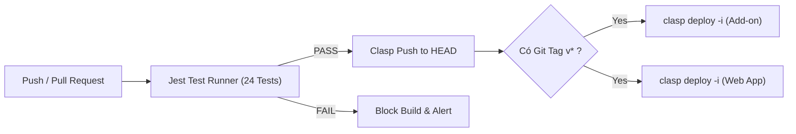

# 📬 MailMerge Pro — Google Sheets Automation Engine

[](https://github.com/TrongShuKi/mailmerge/actions/workflows/deploy.yml)
[](https://github.com/TrongShuKi/mailmerge/releases)
[]()
[]()


> Giải pháp gửi email hàng loạt tự động, cá nhân hóa trên nền tảng **Google Sheets & Gmail**, tích hợp đầy đủ quy trình **CI/CD** chuẩn công nghiệp.

🎬 **[Xem Video Hướng Dẫn Sử Dụng Nhanh trên YouTube (5 phút)](https://youtu.be/TqpBtVgmmOg)**

---

## 🌟 Tính Năng Nổi Bật (Key Features)

| Tính năng | Mô tả chi tiết |
| :--- | :--- |
| 🏷️ **Cá nhân hóa linh hoạt** | Thay thế linh hoạt thẻ `{{danhxung}}`, `{{ten}}`, `{{link}}` và 8 trường mở rộng `{{other1}}` $\rightarrow$ `{{other8}}`. Hỗ trợ cả thẻ URL-encoded và Hyperlink HTML. |
| 👁️ **Interactive Live Preview** | Xem trước email thực tế với thuật toán **Phân mảnh Cache (Chunking)**, giải quyết triệt để giới hạn 100KB của Google CacheService khi nhúng ảnh Base64 lớn. |
| 📊 **Open Tracking (Thời gian thực)** | Chèn điểm ảnh ẩn 1x1 tự động ghi nhận mốc `Đã xem (HH:mm dd/MM)` vào Sheet. Tích hợp bộ lọc **Chống báo ảo (Cooldown 15s)** để loại bỏ việc Google Image Proxy quét trước. |
| ⏰ **Schedule Manager (Hẹn giờ)** | Lên lịch gửi thư tự động trong tương lai bằng Time-driven Trigger ngầm của Google. Tắt máy tính hệ thống vẫn tự động kích hoạt gửi đúng giờ. |
| 📎 **Đính kèm Google Drive** | Đính kèm nhiều file (PDF, hình ảnh, bảng tính...) từ link chia sẻ Google Drive trong cùng 1 ô, tự động nhận diện và chuyển đổi sang Blob. |
| 🛡️ **Bảo vệ tài khoản & Chống Spam** | Tùy chỉnh thời gian chờ (Delay time 1-2s) giữa các lần gửi. Tự động bỏ qua các dòng đã có trạng thái *"Đã gửi"* và các dòng bị ẩn do Filter/Hide. |
| 🚀 **Chống lỗi Font Emoji** | Tự động mã hóa ký tự Emoji 4-byte phức tạp sang HTML Entities (`&#...;`), không bao giờ bị lỗi hiển thị hay mất icon trên Gmail. |

---

## 🏗️ Kiến Trúc Mã Nguồn (Architecture)

```text
mailmerge/
├── .github/workflows/
│   └── deploy.yml          # CI/CD Pipeline (Test, Clasp Push & Automated Dual Deploy)
├── src/                    # Mã nguồn chính đồng bộ lên Google Apps Script
│   ├── MailMergePro.js     # Core engine xử lý gửi mail, menu và cấu hình
│   ├── TrackingLogic.js    # Endpoint Web App (doGet) nhận tín hiệu Open Tracking
│   ├── ScheduleLogic.js    # Quản lý Trigger hẹn giờ ngầm và dọn dẹp chiến dịch
│   ├── PreviewLogic.js     # Thuật toán phân mảnh bộ đệm cho Live Preview
│   ├── Sidebar.html        # Giao diện điều khiển chính (Material Design)
│   ├── Preview.html        # Giao diện modal xem trước email
│   ├── ScheduleDialog.html # Giao diện quản lý các chiến dịch hẹn giờ
│   ├── Guide.html          # Cẩm nang hướng dẫn sử dụng tích hợp
│   └── appsscript.json     # Manifest khai báo quyền OAuth chuẩn xác
├── tests/
│   └── mailmerge.test.js   # 24 bài Unit Test toàn diện (Jest Test Runner)
└── package.json            # Cấu hình dự án, Jest và Clasp dependencies
```

---

## ⚙️ Quy Trình CI/CD Pipeline

Dự án áp dụng mô hình **Automated Release Pipeline** thông qua GitHub Actions:



1. **Giai đoạn CI (Continuous Integration):**
   * Mỗi Pull Request hoặc Commit lên `main` kích hoạt chạy tự động 24 bài Unit Test. Nếu có lỗi, Pipeline lập tức dừng lại, ngăn chặn đưa mã lỗi lên Production.
2. **Giai đoạn CD (Continuous Delivery):**
   * Đồng bộ tự động mã nguồn mới nhất lên môi trường Apps Script.
3. **Phát hành tự động bằng Git Tag (Zero-touch Release):**
   * Khi tạo tag (VD: `v1.1.2`), Robot tự động cập nhật đè trực tiếp vào 2 Deployment Active (Add-on Google Sheets và Web App Tracking), không cần mở Apps Script thao tác thủ công.
4. **DevSecOps & Bảo mật:**
   * Áp dụng **Template Hydration**: Tuyệt đối không lưu Script ID và OAuth Credentials (`.clasprc.json`, `creds.json`) trên Git công khai. Tất cả được quản lý an toàn qua **GitHub Secrets**.

---

## 🚀 Cài Đặt & Phát Triển Cục Bộ (Local Development)

### Yêu cầu tiên quyết
* [Node.js](https://nodejs.org/) (Khuyến nghị v20+)
* Đã cài đặt [Google Clasp](https://github.com/google/clasp)

### Các bước khởi tạo
```bash
# 1. Clone repository
git clone https://github.com/TrongShuKi/mailmerge.git
cd mailmerge

# 2. Cài đặt các gói phụ thuộc
npm install

# 3. Chạy toàn bộ 24 bài kiểm thử Jest
npm test

# 4. Đẩy mã nguồn thủ công lên Google Apps Script (nếu cần)
npm run push
```

---

## 📖 Hướng Dẫn Sử Dụng Nhanh

1. **Chuẩn bị bản nháp Gmail:** Soạn thư nháp chứa các thẻ `{{danhxung}}`, `{{ten}}`, `{{link}}`...
2. **Chuẩn bị Google Sheets:** Tạo các cột tương ứng, bắt buộc có cột chứa địa chỉ Email.
3. **Mở Bảng điều khiển:** Vào menu **MailMerge $\rightarrow$ Mở Bảng Điều Khiển**.
4. **Gửi hoặc Hẹn giờ:** Bấm **Preview** để kiểm tra $\rightarrow$ **Send Test Email** để kiểm tra trên Gmail của bạn $\rightarrow$ Bấm **Send Email** hoặc chọn **Schedule Manager** để gửi tự động!